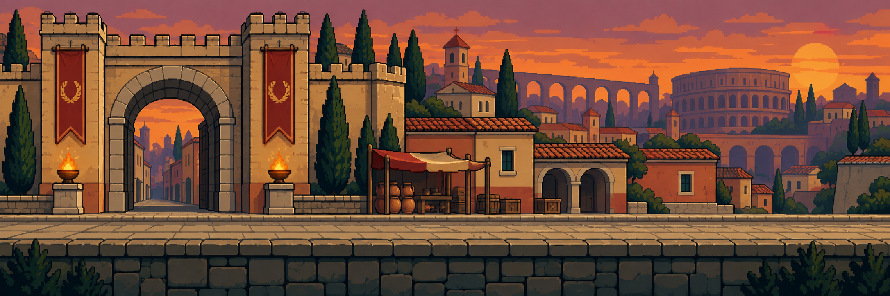

# Memórias Perdidas

**Uma aventura histórica em pixel art sobre investigar o passado e restaurar memórias.**

### [Jogar no navegador →](https://mhueto.github.io/Memorias_perdidas/)

[Abrir a campanha de Roma](https://mhueto.github.io/Memorias_perdidas/campanha-roma.html) · [Testar a queda](https://mhueto.github.io/Memorias_perdidas/roma.html?intro=1) · [Relatar um problema](https://github.com/MHueto/Memorias_perdidas/issues/new/choose) · [Guias do projeto](docs/README.md) · [Novidades](CHANGELOG.md)

[](https://github.com/MHueto/Memorias_perdidas/actions/workflows/verify.yml)

> **Protótipo em desenvolvimento.** Esta revisão reúne a escola, o Cofre e quatro etapas jogáveis de Roma: fundação, expansão, Pax Romana e queda do governo ocidental. Jogue diretamente pelo navegador, sem instalar o jogo.



## Sobre o jogo

Renato está indo embora da escola quando percebe que esqueceu o celular. O que parecia uma volta rápida à sala de aula o leva ao **Cofre das Memórias**, um lugar que preserva fragmentos de momentos históricos.

Algumas dessas memórias foram alteradas. Renato percorre quatro momentos de Roma: cabe a ele conversar com moradores, explorar os ambientes e comparar as pistas com os registros originais que carrega.

O objetivo é **aprender história por meio da investigação**. Os livros não são reescritos pelo jogador: eles ajudam a descobrir o que foi alterado na memória e a restaurar o curso dos acontecimentos.

## Como testar

1. Abra **[Jogar no navegador](https://mhueto.github.io/Memorias_perdidas/)**.
2. No menu, escolha **Jogar → Novo Jogo → Jogo 1** (ou outro espaço disponível).
3. Avance a conversa inicial e explore a escola.
4. Para começar direto na parte histórica, abra a **[campanha de Roma](https://mhueto.github.io/Memorias_perdidas/campanha-roma.html)**.

**Quatro memórias em sequência:** no menu, escolha **Jogar → Memórias de Roma**. A fundação abre primeiro; os demais períodos são liberados conforme você conclui as etapas. **Continuar** retoma a linha do tempo quando já há progresso romano. O [atalho da queda](https://mhueto.github.io/Memorias_perdidas/roma.html?intro=1) continua disponível para testar apenas essa fase.

**No celular:** use os botões na tela. A orientação horizontal oferece mais espaço para enxergar os cenários. O carregamento inicial pode demorar conforme a conexão.

**Progresso:** a campanha salva o avanço no próprio navegador. Não há sincronização entre aparelhos, navegadores ou a versão em `localhost`. Os espaços Jogo 1/2/3 do menu não são três campanhas romanas independentes. Saves antigos da queda são preservados; para recomeçar apenas a queda, abra **Mapa → Reiniciar Roma** e confirme. Veja [como funcionam os saves](docs/campanha-roma-v11.md).

## Controles

| Ação | Escola e cofre | Roma |
| --- | --- | --- |
| Andar | `A` / `D` ou `←` / `→` | `A` / `D` ou `←` / `→` |
| Entrar ou interagir | `W` ou `↑` | `E`, `W` ou `↑` |
| Pular | `Espaço` | — |
| Usar a ação do desafio | — | `Espaço`, quando solicitado |
| Abrir mapa ou roteiro | — | `M` |
| Consultar os livros | — | `B` |
| Avançar uma conversa | Botão **Continuar** ou `Enter` | Botão **Continuar** ou `Enter` |

Em dispositivos de toque, os controles de movimento e interação aparecem na tela.

## O que já está disponível

- Introdução na escola, encontro com Lily e busca pelo celular.
- Viagem até o Cofre das Memórias, corredores conectados e encontro com Pedro Neves.
- Entrada na memória de Roma, com mercado, Foro, Coliseu, oficina, bairro residencial, pátio e Senado.
- Investigação sobre o fim do Império Romano do Ocidente, com livros, pistas, diálogos e viagem a Ravena.
- Ajuda da missão, leitura guiada, explicações de cada resposta e revisão do que foi aprendido.
- Mapa de orientação: mostra a posição e os caminhos, **sem teletransportar o personagem**.
- Desafios de exploração, coleta de objetos e recuperação de uma memória na arena.
- Efeitos visuais de deterioração da memória ao longo da partida.
- Três novos cenários, nove investigações com consulta aos livros e desafios de construção, abastecimento e escoamento de água; progressão até a queda e encerramento das quatro memórias.

### Escopo da campanha

O jogo concentra-se em **Roma**, com quatro etapas conectadas pela linha do tempo. A introdução na escola e no Cofre foi preservada. Cada época tem investigação e desafios próprios.

As Cruzadas e a Peste Negra pertencem ao planejamento anterior e não fazem parte do escopo atual. Os documentos de pesquisa foram preservados como referência. Veja o [escopo e o estado de cada etapa](docs/ESCOPO.md).

## História e ficção

A campanha distingue lenda e evidência nas origens, explora a expansão republicana em 146 a.C., visita a Pax Romana em 117 d.C. e termina em **475–476 d.C.**, com a deposição de Rômulo Augústulo, marco convencional do fim do Império Romano do Ocidente. São recortes separados por séculos; expansão e Pax Romana se sobrepõem.

A viagem temporal, os personagens do presente, os obstáculos da investigação e o desafio dos leões são elementos de ficção. A deterioração visual representa uma **memória instável**: não significa que a cidade de Roma tenha sido completamente destruída em 476, nem que o Império Romano do Oriente tenha terminado nessa data.

Os livros de Renato apresentam referências para consulta. Veja também:

- [Pesquisa histórica para o jogo](docs/Pesquisa_historica_para_o_jogo.md).
- [Estrutura da investigação de Roma](docs/roma-investigacao-v8.md).
- [Mapa e orientação na fase](docs/roma-orientacao-v9.md).
- [Como funcionam as pistas guiadas e a aprendizagem](docs/roma-aprendizagem-v10.md).
- [Campanha romana: etapas, fontes e funcionamento](docs/campanha-roma-v11.md).

Esses documentos fazem parte do desenvolvimento e podem conter spoilers ou ideias de versões anteriores.

## Executar no computador

O jogo usa **HTML, CSS e JavaScript**, sem etapa de compilação.

1. Baixe o projeto em **Code → Download ZIP** e extraia a pasta, ou clone o repositório:

   ```bash
   git clone https://github.com/MHueto/Memorias_perdidas.git
   cd Memorias_perdidas
   ```

2. Com Python 3 instalado, abra um terminal nessa pasta e inicie um servidor local:

   ```bash
   python -m http.server 8080 --bind 127.0.0.1
   ```

   No Windows, se o comando `python` não estiver disponível, use `py -3` no lugar de `python`. Também é possível usar a extensão Live Server do VS Code.

3. Abra **http://localhost:8080/** no navegador. Mantenha o terminal aberto enquanto joga; para encerrar, pressione `Ctrl+C`.

## Organização dos arquivos

```text
Memorias_perdidas/
├── index.html             Menu principal
├── teste-escola.html      Escola, cofre e introdução
├── roma.html              Memória da queda de Roma
├── campanha-roma.html     Linha do tempo das quatro memórias
├── roma-jornadas.html     Fundação, expansão e Pax Romana
├── css/                   Estilos e interface
├── js/                    Movimento, diálogos, investigação e mapa
├── assets/                Cenários, sprites e outros recursos
├── docs/                  Pesquisa histórica e documentação
├── scripts/               Verificação de arquivos e testes do verificador
├── .github/               Formulários de problemas e verificação automática
├── CONTRIBUTING.md        Orientações para contribuir
├── CHANGELOG.md           Histórico das atualizações
└── .nojekyll              Publicação estática pelo GitHub Pages
```

Para localizar a lógica de cada cena, ajustar a altura do chão ou trocar imagens, consulte o **[guia de desenvolvimento](docs/DESENVOLVIMENTO.md)**. O **[índice da documentação](docs/README.md)** separa o funcionamento atual dos registros de versões anteriores.

Com Node.js 24 instalado, é possível conferir o projeto sem instalar pacotes:

```bash
node --test scripts/check-project.test.cjs
node --test scripts/check-learning.test.cjs
node --test scripts/check-campaign.test.cjs
node scripts/check-project.cjs
```

A verificação confere sintaxe e referências locais, incluindo diferenças de maiúsculas/minúsculas nos nomes. Ela também roda no GitHub, mas não substitui jogar e testar as interações. Veja [como contribuir](CONTRIBUTING.md).

## Publicação da demonstração

A demonstração usa **GitHub Pages**, configurado para publicar a raiz da branch `master`. Depois que uma alteração é enviada para essa branch, o GitHub prepara uma nova publicação; o link do jogo permanece o mesmo.

Consulte [Settings → Pages](https://github.com/MHueto/Memorias_perdidas/settings/pages) para verificar a configuração e [Actions](https://github.com/MHueto/Memorias_perdidas/actions) para acompanhar a publicação. Esses ajustes exigem permissão no repositório. O [checklist de publicação](docs/PUBLICACAO.md) explica como conferir uma atualização sem apagar o progresso de teste.

## Encontrou um problema?

[Abra uma issue usando os formulários](https://github.com/MHueto/Memorias_perdidas/issues/new/choose) com:

- O ambiente em que aconteceu: escola, cofre ou nome da área de Roma.
- O que você fez antes do problema.
- O que esperava acontecer e o que aconteceu.
- Seu navegador e se estava jogando no computador ou celular.
- Uma captura de tela, se possível.

Por ser um protótipo, a arte, os controles, a apresentação e o conteúdo ainda podem mudar. O foco é uma campanha compreensível e educativa, que precisa continuar sendo testada com jogadores reais.

---

Projeto de **[MHueto](https://github.com/MHueto)**.
